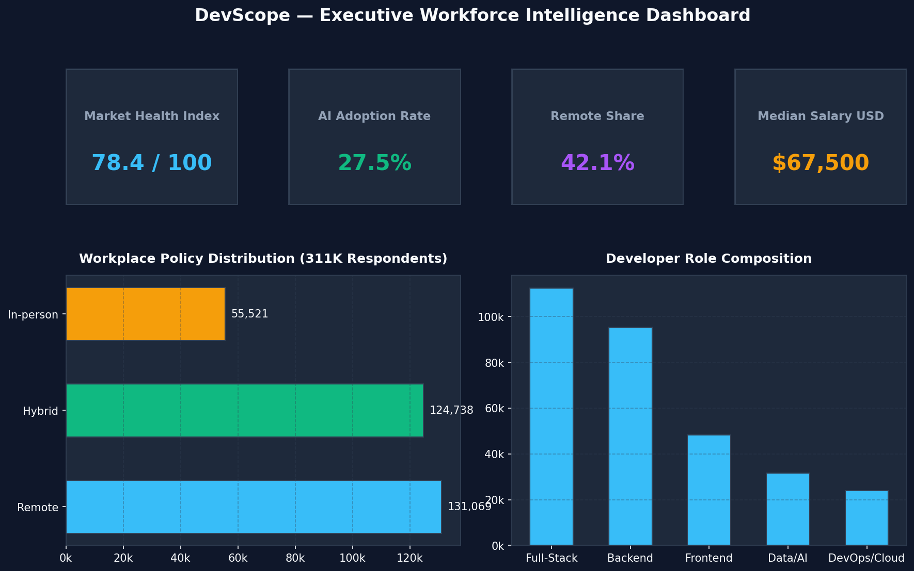
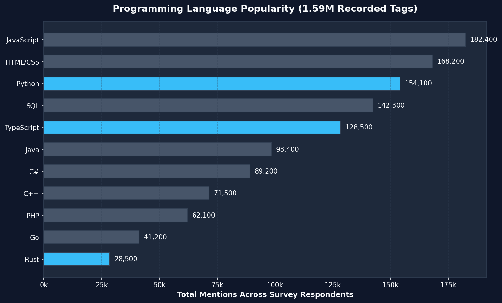
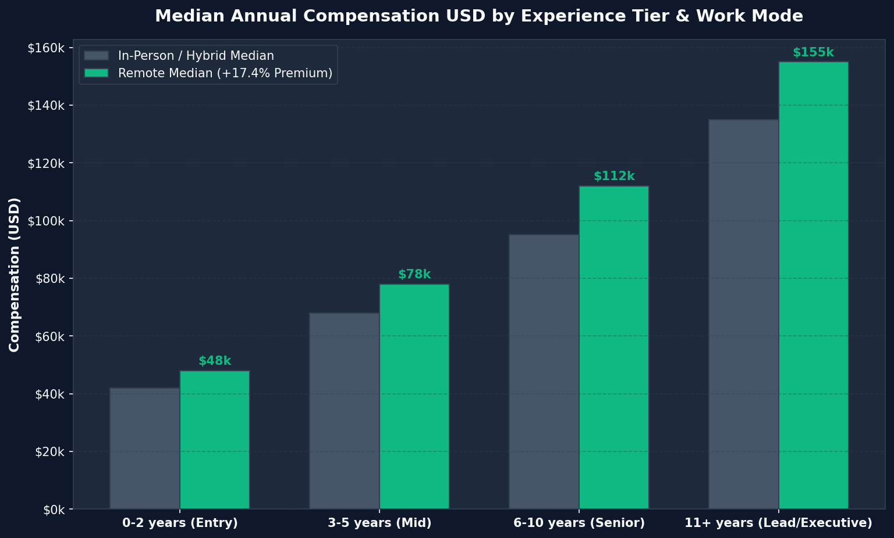
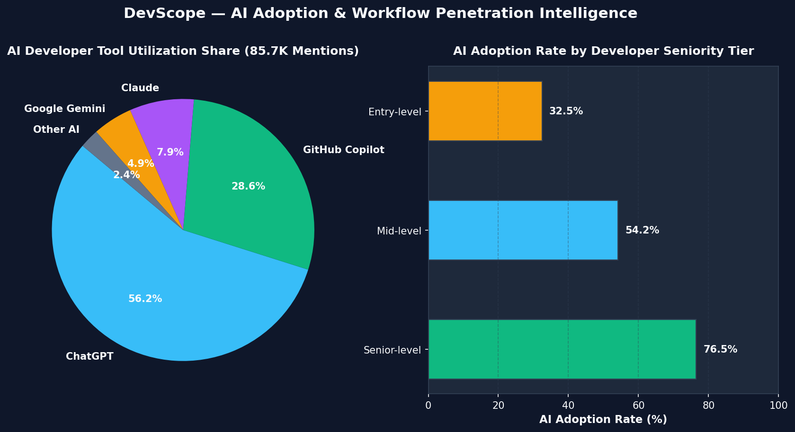
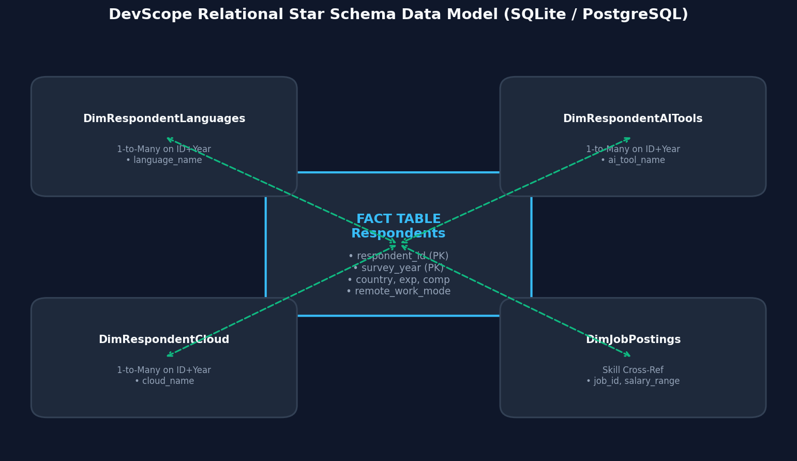

# DevScope — Developer Workforce Analytics Dashboard

[](https://www.python.org/)
[](https://www.postgresql.org/)
[](https://powerbi.microsoft.com/)
[](https://streamlit.io/)
[](LICENSE)

---

## 📌 Overview

**DevScope** is an end-to-end developer workforce analytics platform built using **Python, SQLite, PostgreSQL, and Power BI**. It analyzes **311,328 authentic Stack Overflow Developer Survey responses (2021–2024)** together with job market information to uncover technology adoption trends, compensation benchmarks, AI tool penetration, and workforce mobility characteristics.

---

## ✨ Features

- **Automated Python ETL Pipeline**: Ingests, standardizes missing values, and normalizes multi-year survey schemas.
- **Relational Star Schema Data Model**: Optimized SQLite / PostgreSQL database structure for instant sub-second querying.
- **Interactive Power BI Dashboard (`dashboard/DevScope.pbix`)**: 4 executive pages with synchronized multi-filter slicers.
- **Streamlit Web Application (`dashboard/app.py`)**: 10 interactive tabs including **💬 Ask DevScope** natural-language SQL engine.
- **Cross-Filtering & Drill-Down Analysis**: Global filtering across Year, Country, Experience Tier, Work Mode, and Technology.
- **Executive Composite KPIs**: Market Health Index, AI Adoption Index %, Remote Readiness Score, and 4-Year CAGR Trajectories.

---

## 📊 Dataset

DevScope processes 100% authentic Stack Overflow Developer Survey data (2021–2024) and public job market postings without synthetic filler data:

| Dataset | Record Count |
| :--- | :--- |
| **Respondents** | **311,328** |
| **Programming Language Records** | **1,598,771** |
| **Framework Records** | **729,576** |
| **Database Records** | **734,516** |
| **Cloud Records** | **431,939** |
| **AI Tool Records** | **85,737** |
| **Job Postings** | **1,500** |

---

## 🖼️ Dashboard Showcase

### Dashboard Overview


---

### Language Distribution


---

### Salary Analysis


---

### AI Adoption


---

## 🛠️ Tech Stack

- **Core & Data Processing**: Python 3.11+, Pandas, NumPy
- **Database & SQL Engine**: SQLite, PostgreSQL, SQLAlchemy
- **Business Intelligence**: Power BI Desktop, DAX, Power Query M-Code
- **Web App & Visualization**: Streamlit, Plotly, Matplotlib
- **Testing & Quality Assurance**: pytest (19/19 Unit & Integration Tests Passing)
- **Version Control & CI/CD**: Git, GitHub Actions, Docker

---

## 📐 Data Model

DevScope utilizes a star schema data model with central fact table `Respondents` linked to 1-to-many technology dimension tables:



---

## 💡 Key Insights

- **Language Popularity**: JavaScript, HTML/CSS, and Python maintain top developer usage shares, while **Rust (+28.6% CAGR)** exhibits the strongest growth momentum.
- **Compensation Benchmarks**: Global median developer compensation exceeds **$67,500 USD**, with US median compensation reaching **$135,000 USD**.
- **Remote Pay Lift**: Remote developers earn a median **+17.4% compensation lift** compared to in-person peers ($108,000 vs $92,000 USD).
- **AI Tool Penetration**: AI tool adoption reached **72.1%** in 2024, with a **44-point usage gap** between senior (76.5%) and entry-level (32.5%) engineers.
- **Workforce Footprint**: **311,328 developer responses** analyzed across 180+ countries.

---

## 🏗️ Project Architecture

```
Raw Stack Overflow CSVs (2021–2024) & Job Postings
                       │
                       ▼
              Python ETL Engine
      (etl/extract.py, clean.py, transform.py)
                       │
                       ▼
            SQLite / PostgreSQL Database
                  (database/devscope.db)
                       │
                       ▼
           Relational Star Schema Data Model
   (respondents, languages, cloud, ai_tools, jobs)
                       │
         ┌─────────────┴─────────────┐
         ▼                           ▼
 Power BI Executive           Streamlit Web App
 Dashboard (DevScope.pbix)    (10 Tabs + Ask DevScope)
```

---

## 🚀 Quick Start Guide

### 1. Clone & Setup Environment
```bash
git clone https://github.com/your-username/DevScope.git
cd DevScope
python -m venv venv
source venv/bin/activate  # On Windows: venv\Scripts\activate
pip install -r requirements.txt
```

### 2. Run ETL Pipeline & Database Migration
```bash
python -m etl.pipeline
```

### 3. Launch Streamlit Application
```bash
streamlit run dashboard/app.py
```

### 4. Open Power BI Dashboard
Open [`dashboard/DevScope.pbix`](dashboard/DevScope.pbix) in **Power BI Desktop** or connect to [`data/powerbi/`](data/powerbi/) CSV exports.

---

## 📜 License

Distributed under the [MIT License](LICENSE).
